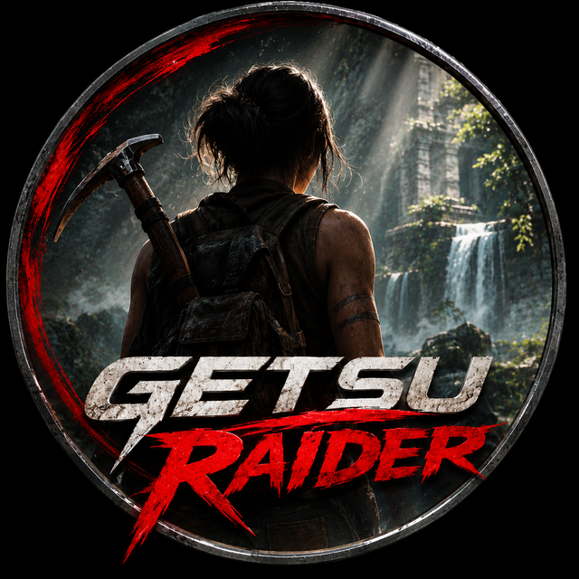

<p align="center"></p>

# GETSU RAIDER

A shareable PS5 homebrew tile (title **PPSA99606**) that runs **Shadow of the
Tomb Raider**, by **CHI-GETSU**. Part of the GETSU (月) line of homebrew, after
[GETSU SOTF](https://github.com/CHI-GETSU/GETSU-SOTF-PS5-Homebrew).

GETSU RAIDER bundles its own game runtime, so **you do not need to install
Prospero Win separately**. The tile carries Wine, vkd3d-proton (Direct3D 12),
the RADV graphics driver and everything else it needs. You bring your own
legal copy of the game.

**Local test status:** the PPSA99606 helper and `eboot.bin` have now been built
and integrated into the existing runtime folder. This exact RAIDER tile has
not been tested on a PS5. Earlier gameplay observations concern the reference
Prospero Win setup, not this new tile. The local test ZIP is not a public release.
See `ETAT.md` and `source-notes/BUILD-VERIFICATION.json` for the evidence.

## What makes it different

GETSU RAIDER is **not** the Prospero Win launcher. It uses the GETSU
front-end: a single screen that walks you through four steps (welcome, drop
the game, install, play), with the moon's halo as the install progress bar.
All of its artwork, font and logic are original (`native/getsu_landing.c`).

## Install

1. Copy the `PPSA99606/` folder to `/data/homebrew/PPSA99606/` on your
   jailbroken PS5 (the usual homebrew location).
2. Launch **GETSU RAIDER** from the home screen once. On this first run it
   creates its own data folder and, inside it, the place you drop the game:

   ```
   /data/getsu-raider/
   ├── dropzone/ShadowOfTheTombRaider/   ← copy YOUR game here
   ├── prefixes/sottr/                   ← the game is installed here
   ├── profiles/sottr.profile
   └── logs/
   ```

3. Copy the **contents** of your own Shadow of the Tomb Raider install folder
   (the folder that holds `SOTTR.exe`) into `dropzone/ShadowOfTheTombRaider/`.
   The game was tested with the normal, unmodified **GOG** install.
4. Open GETSU RAIDER again. When it sees the game, press **✕** to install,
   then **✕** to play. **△** re-installs (repair), **◯** goes back.

## Graphics settings

The game runs in **Direct3D 12** (vkd3d-proton), at **2560 × 1440**, with
**ray tracing off**.

### Tested configurations

```
┌─────────────────────────────────────────────────────┐
│                                                     │
│  ⭐ ULTRA QUALITY (TESTED & VERIFIED)              │
│                                                     │
│  Resolution:  2560 × 1440 (2K)                     │
│  API:         Direct3D 12 (vkd3d-proton 3.0.1)     │
│  Textures:    ULTRA                                 │
│  Shadows:     ULTRA                                 │
│  LOD:         ULTRA                                 │
│  AO:          ULTRA                                 │
│  Filtering:   ULTRA                                 │
│  Status:      ✓ SMOOTH 60 FPS (extended play)     │
│                                                     │
└─────────────────────────────────────────────────────┘

┌─────────────────────────────────────────────────────┐
│                                                     │
│  🎮 DEFAULT CAUTIOUS (PRE-CONFIGURED)              │
│                                                     │
│  Resolution:  2560 × 1440 (2K)                     │
│  Textures:    MEDIUM                                │
│  Shadows:     HIGH                                  │
│  LOD:         HIGH                                  │
│  Filtering:   HIGH                                  │
│  Status:      ✓ STABLE (tested on console)        │
│                                                     │
└─────────────────────────────────────────────────────┘
```

On install, GETSU sets the game to the cautious preset. **But GETSU RAIDER has been
tested running at ultra quality settings in 2K** — all texture, shadow, LOD, ambient
occlusion and filtering sliders maxed — **and plays smoothly for extended gaming
sessions.**

You can change any setting in the game's options; GETSU never overwrites settings
you have changed (it only writes them into a new install).

The first start after an install can stay several minutes on the loading
screen: let it load.

## Controls (the GETSU screen)

| Button | Action |
|--------|--------|
| ✕ Cross | Begin / Install / Play |
| ◯ Circle | Back |
| △ Triangle | Repair (re-copy from the dropzone) |

## You must bring your own game

GETSU RAIDER ships **no game data**. Shadow of the Tomb Raider is not
included; use the copy you own.

## Licence & source

Free software. Prospero Win, Wine and our page-file changes are
LGPL-2.1-or-later; the title as a whole is GPL-3.0-or-later (it links the PS5
native boilerplate and SDK); RADV/Mesa is MIT. The full licence texts are in
`PPSA99606/LICENSES/`, and `PPSA99606/THIRD_PARTY.md` + `SOURCES.txt` say what
each part is and where its source is. The complete corresponding source,
including our modifications, must accompany the future public release.
`GETSU-RAIDER-PPSA99606-DEVELOPMENT-SOURCE.zip` is a development snapshot
including our changes and the pinned Lapy sources; it is not a claim that
all upstream dependency source-distribution obligations are closed.
The current development tree is `~/.cache/getsu/raider-src` and its build
procedure is in `source-notes/BUILDING-GETSU-RAIDER.md`.

## Credits

- **[Prospero Win](https://github.com/mpereiraesaa/prospero-win)**: mpereiraesaa
  and contributors (LGPL-2.1-or-later), including its
  [DXVK fork](https://github.com/mpereiraesaa/dxvk) and the
  [PS5_Mesa](https://github.com/mpereiraesaa/PS5_Mesa) port of Mesa/RADV.
- **[PS5 Lapy JB Daemon](https://github.com/ArkSama/PS5-Lapy-JB-Daemon)**:
  ArkSama (Team PHU), MIT.
- **[PS5 Native App Boilerplate](https://github.com/drakmor/ps5-native-app-boilerplate)**:
  BlackBearReloaded (GPL-3.0-or-later).
- **[PS5_Vulkan](https://github.com/mihawk-99/PS5_Vulkan)**, the
  [PS5_PayloadSDK](https://github.com/mihawk-99/PS5_PayloadSDK) fork and
  **[MihawkGen](https://github.com/mihawk-99/PS5_MihawkGen)**: mihawk-99
  (GPL-3.0-or-later).
- **[PS5 payload SDK](https://github.com/ps5-payload-dev/sdk)**: the
  ps5-payload-dev project (GPL-3.0-or-later).
- **[Wine](https://www.winehq.org)**, **[DXVK](https://github.com/doitsujin/dxvk)**
  and **[vkd3d-proton](https://github.com/HansKristian-Work/vkd3d-proton)**:
  their authors.
- **[Mesa / RADV](https://mesa3d.org)**: the Mesa project.
- The PS5 video-out tile permutation: adapted from **John Törnblom**'s SDL PS5
  backend (zlib).
- GETSU RAIDER front-end, page-file and integration: **CHI-GETSU**.

GETSU RAIDER is a fan homebrew and is not affiliated with Crystal Dynamics,
Eidos-Montréal, Square Enix, Embracer Group or Sony. "Shadow of the Tomb
Raider" and "Tomb Raider" are the property of their owners.
